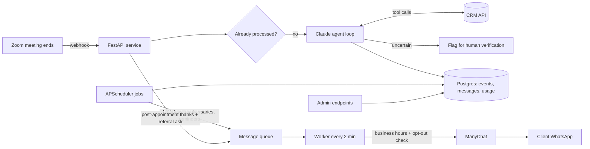

# Insurance AI Agent: Zoom to CRM, plus WhatsApp follow-ups

An AI agent for an independent insurance agent. When a Zoom meeting ends, the agent reads the transcript, updates the client's CRM record with Claude, and schedules the personal follow-up messages the agent would otherwise send by hand.

> The source code is private because it is in production for a client. The client is anonymized on this page and all example data is fictional.

## The problem

An insurance agent spends the day in video calls. After each one, someone has to log what was said (new family details, coverage needs, referrals, tasks) and remember to follow up on birthdays, policy anniversaries and appointments. Details slipped through and follow-ups depended on memory.

## How it works

1. **Zoom webhook:** FastAPI receives the meeting summary and transcript events. A per-meeting lock makes the webhook idempotent, so a duplicate delivery never processes a meeting twice.
2. **Claude agent with tools:** the model reads the transcript and calls CRM tools to find or create the contact, update personal data, record the financial needs analysis, add referrals and family relationships, create tasks and notes, and update the lead or opportunity.
3. **Safety rails:** the agent can only mutate the records it has identified for that meeting. Meetings with several participants require extra verification, and anything uncertain is flagged for a human to review instead of being written silently.
4. **Follow-up engine:** an APScheduler worker queues messages for birthdays, policy anniversaries, six-month check-ins, meeting reminders, holiday greetings and, after a first appointment, a thank-you and a referral request.
5. **WhatsApp delivery:** a worker runs every two minutes and sends through ManyChat, respecting business hours and client opt-outs, with retries and an admin console to retry or cancel individual messages.
6. **Cost and audit trail:** every Claude call is logged with tokens and estimated cost, and admin endpoints expose meetings, webhook history and usage.

## Architecture

## Tech stack

- **Python 3, FastAPI, Uvicorn**
- **Claude API** (Anthropic SDK) with tool use and cost logging
- **APScheduler** for cron and interval jobs
- **Postgres** (psycopg2) for events, message queue and usage
- **ManyChat** for WhatsApp, **Zoom** webhooks and API
- Deployed on **Railway**
- Migration scripts to move the client's data from a legacy CRM to the new one

## Highlights

- **Human in the loop by design:** ambiguous people or names go to a verification queue.
- **Time-aware messaging:** timezone-aware scheduling and a business-hours window for every outgoing message.
- **Test suite:** 39 files under `tests/` covering the extractor, follow-up scenarios, opt-outs, meeting reminders, template naming and admin routes.
- **Operational tooling:** unlock a webhook, replay a meeting, run daily jobs on demand, inspect per-contact message history.

[Back to profile](https://github.com/Ernesto-9)

See more projects on my [GitHub profile](https://github.com/Ernesto-9).
